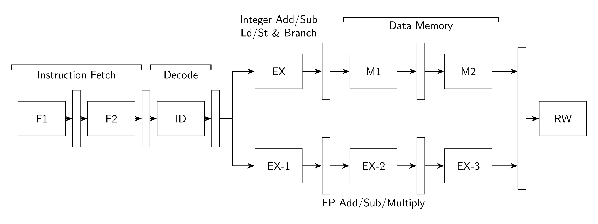
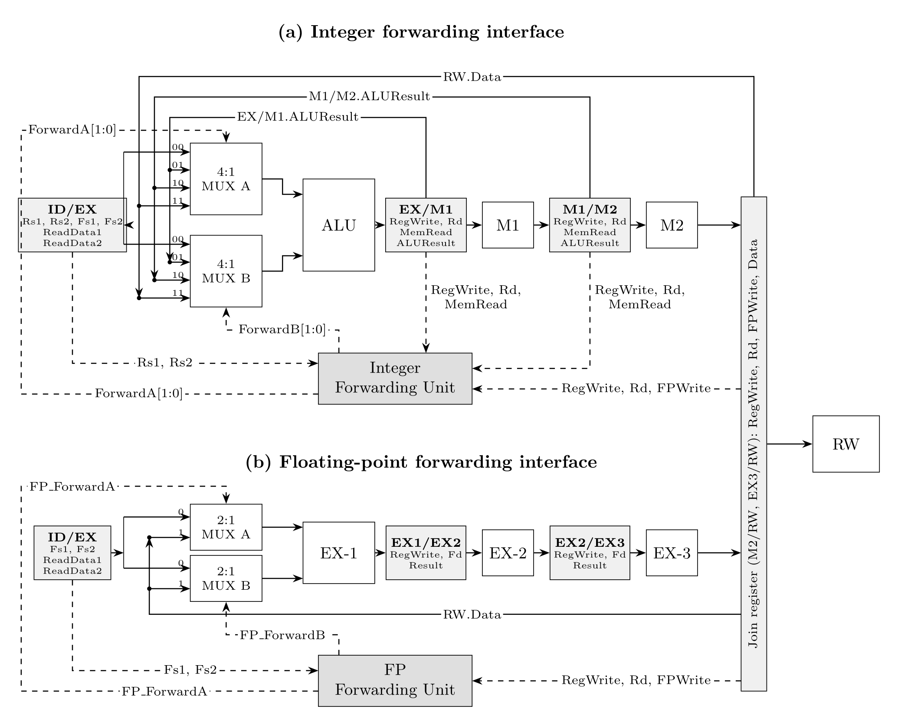
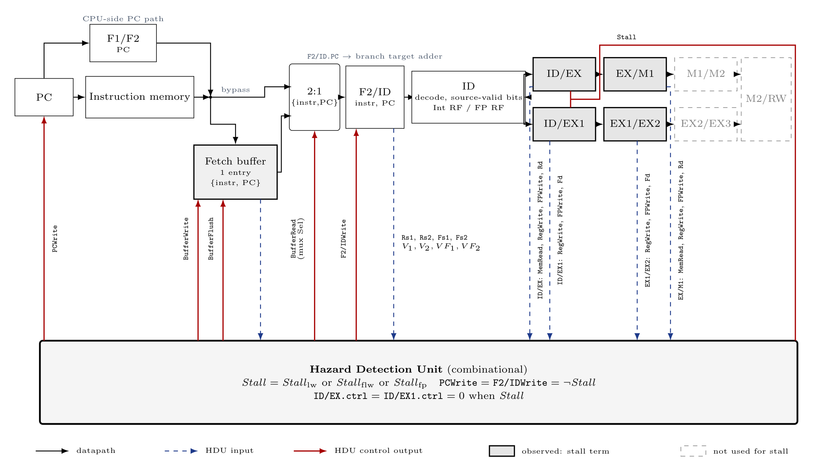
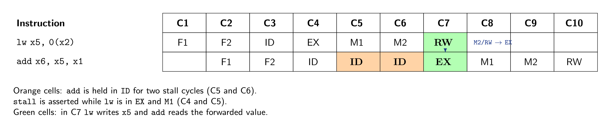
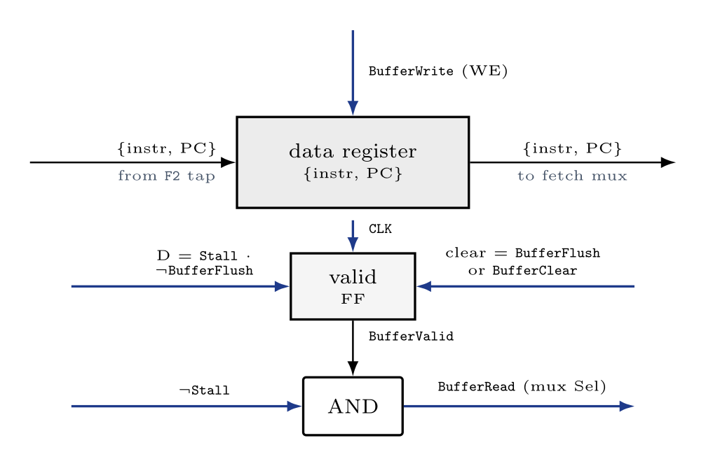
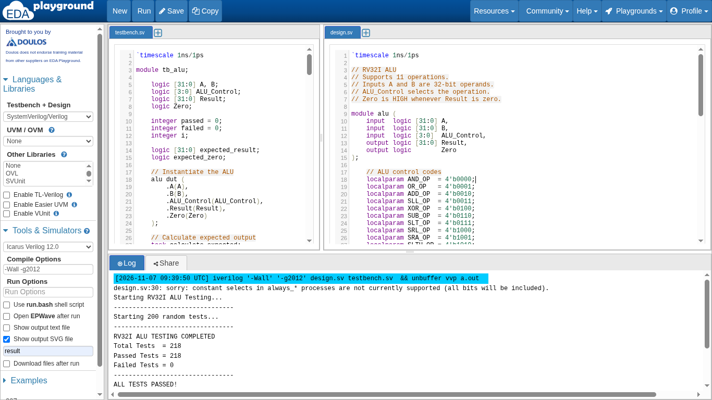

# RV32I Dual-Lane Pipeline



**One front end. Two three-stage execution lanes. One shared write-back.**

A 7-stage RISC-V pipeline study with parallel integer/memory and floating-point paths, custom TikZ datapaths, hazard/forwarding analysis, and a verified RV32I ALU.


## Why this design is interesting

This is not a standard 5-stage pipeline. The front end and write-back are shared, but execution splits into two balanced lanes:

| Segment | Stages | Role |
|---|---|---|
| Shared front end | `F1 → F2 → ID` | Instruction fetch, decode, register-file read |
| Integer / memory lane | `EX → M1 → M2` | Integer ALU, loads/stores, branches |
| FP lane | `EX-1 → EX-2 → EX-3` | Floating-point add/sub/multiply |
| Shared write-back | `RW` | Register-file write for both lanes |

**Both execution lanes are exactly three stages deep.** That balance lets the integer and FP paths rejoin at `RW` without a depth-mismatch buffer. The unified instruction/data memory is also pipelined into two stages (`F1`/`M1` and `F2`/`M2`), which is what makes the structural-hazard analysis interesting: a memory operation in `M1` can collide with an instruction fetch entering `F1`.

Consequences explored in the report:

- **Structural hazards:** a unified pipelined memory shared by fetch and data access; software NOPs cannot fix it, but a one-cycle hardware stall can.
- **Two forwarding domains:** integer bypasses from `EX/M1`, `M1/M2`, and `M2/RW` into `EX`; FP forwarding at the shared write-back into `EX-1`.
- **One HDU for both lanes:** load-use stalls (`lw`/`flw`), FP ALU stalls, and `fsw`, which needs both an integer base and FP store data.
- **One `Stall` signal:** it zeroes both `ID/EX` and `ID/EX1` control words, because only one lane carries a real instruction in any cycle.
- **Deeper control-hazard penalty:** a 2-bit saturating predictor is evaluated against the 7-stage timing.

## Key results

| Configuration | Clock | CPI | Time / instruction | Speedup vs. no forwarding |
|---|---:|---:|---:|---:|
| No forwarding | 160 ps | 3.67 | 587.2 ps | 1.00× |
| Only `EX/M1 → EX` | 160 ps | 3.07 | 491.2 ps | 1.20× |
| Only `M1/M2 → EX` | 160 ps | 2.92 | 467.2 ps | 1.26× |
| Only `M2/RW → EX` | 160 ps | 2.67 | 427.2 ps | 1.375× |
| Full ALU forwarding | 200 ps | 1.82 | 364.0 ps | **1.61×** |

Full forwarding is the fastest overall despite the longer clock, because the CPI drop outweighs the 25% cycle-time penalty. If the 160 ps clock must be preserved, `M2/RW`-only forwarding is the best single-path choice.

Branch prediction: 3 mispredictions out of 11 branches with a 2-bit saturating counter (**27.27%**).

## Datapath figures

### Forwarding unit interfaces



### Hazard detection unit and ID-stage interface



### Load-use stall timing



### Single-entry fetch buffer



## RTL verification

The SystemVerilog module is a combinational RV32I ALU with 11 operations, 32-bit operands, and a `Zero` flag. The self-checking testbench applies:

- 11 directed tests with independently computed expected values
- 7 edge cases (overflow, `0 - 1`, shift masking, unused control code, shift boundaries)
- 200 randomized tests against a golden model

**Result: 218/218 tests passed.**



## Build and test

```bash
make            # build main.pdf
make figures    # re-export README figures (needs pdftocairo)
make test       # run the ALU testbench (needs iverilog)
make clean      # remove LaTeX build artifacts
```

Equivalent manual commands:

```bash
latexmk -pdf main.tex
iverilog -g2012 -o build/alu_tb design.sv testbench.sv
vvp build/alu_tb
```

CI compiles the report, re-exports the figures, and runs the ALU testbench on every push.

## Repository layout

```text
main.tex                 25-page LaTeX report
main.pdf                 built PDF
design.sv                synthesizable RV32I ALU
testbench.sv             self-checking ALU testbench
diagrams/                TikZ sources for all report figures
assets/                  exported PNGs used in this README
scripts/export-figures.sh figure export helper
Makefile                 build, test, figure, and clean targets
.github/workflows/ci.yml LaTeX + RTL CI
```

`assets/social-preview.png` is a ready-to-use GitHub social preview image.

## GitHub setup checklist

1. Create the repository and push this folder (no remote is configured yet).
2. In **Settings → General → Social preview**, upload `assets/social-preview.png`.
3. Add topics: `computer-architecture`, `risc-v`, `rv32i`, `systemverilog`, `pipeline`, `hazard-detection`, `fp-pipeline`, `latex`, `tikz`.
4. Pin the repository on your profile.
5. Tag `v1.0` and attach `main.pdf` to a GitHub Release.

## AI and tool declaration

AI assisted with converting hand-drawn diagrams into TikZ, report formatting and language, and the initial two-entry fetch-buffer idea. The two-entry idea was analysed and replaced with a simpler single-entry buffer in the final design. The SystemVerilog design and testbench were compiled and simulated with EDA Playground. Technical analysis and conclusions remain the authors' responsibility. See the final section of `main.pdf` for the full declaration.

## Limitations and next steps

- The RTL in this repository is the selected ALU module, not a full CPU implementation.
- The pipeline, forwarding, HDU, and predictor results are analytic and simulation-based, not synthesis-timing results.
- Natural extensions: integrate the ALU into the pipeline RTL, add branch-resolution hardware, synthesise the dual-lane datapath, and compare against measured post-synthesis timing.

## Licence

Code and tooling are MIT licensed (see `LICENSE`). The report and exported figures are CC BY 4.0 (see `REPORT-LICENSE.md`).
